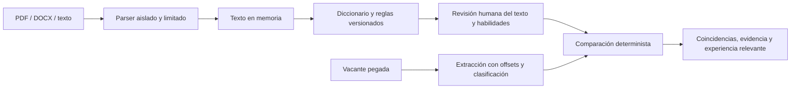

# Career Intelligence AI — arquitectura del MVP local v0.3

## Problema y criterio de éxito

Una persona necesita comparar su CV con una vacante y entender el resultado con fragmentos verificables. La entrega local debe procesar PDF/DOCX, permitir corregir la extracción y distinguir menciones obligatorias, deseables y sin clasificación explícita. El éxito sobre datos reales se decide con un corpus autorizado y etiquetado, no con el aspecto de la demo.

## Flujo implementado

FastAPI sirve la API y el build de React 19, TypeScript y Tailwind CSS 4 del mismo origen. Vite 8 compila el frontend; el runtime local solo necesita Python. [Arquitectura del frontend](frontend.md). `documents.py` transforma bytes en texto; `evidence.py` extrae menciones con posición y compara; `evaluation.py` evalúa contra etiquetas manuales. `core.py` y el CLI mantienen la analítica de vacantes anterior, con IDs estables, deduplicación exacta, cuarentena de filas inválidas y demanda agregada.

## Decisiones

| Decisión | Razón | Condición para cambiar |
| --- | --- | --- |
| Monolito local, un usuario | Facilita operación y evita exponer CV | Usuarios remotos con necesidad real, autenticación y modelo de amenazas definido |
| Sin persistencia en la interfaz | Reduce retención de información personal | Historial solicitado; entonces separar CV privado, política de retención y borrado verificable |
| Diccionario y reglas como baseline | Extracción trazable, barata y reproducible | Errores medidos que justifiquen otro extractor; comparar ambos sobre el mismo conjunto reservado |
| Revisión humana obligatoria en UI | Parsers y reglas pueden omitir o confundir texto | Mantener revisión incluso si se añade un modelo |
| Bytes HTTP, sin multipart | No crear archivos temporales por spool del framework | Necesidad de cargas grandes con almacenamiento privado y ciclo de eliminación explícito |
| Proceso separado por documento | Timeout y terminación efectiva; limitar concurrencia | Colas persistentes si volumen y SLO lo justifican |
| SPA React por funcionalidades | Flujo privado con API Python existente; componentes, contratos y estado separados | Rutas adicionales requieren router; SSR/SEO requerirían reevaluar el framework |
| Estado local con useReducer y peticiones cancelables | Una sesión efímera; reglas de revisión centralizadas y sin caché de CV | Consultas compartidas e historial podrían justificar una librería de estado de servidor |
| Evaluación JSON local | Reproducibilidad sin infraestructura adicional | Versionado de múltiples experimentos; MLflow puede aportar trazabilidad |

## Contratos y linaje

- `schema_version=1.0` para comparación y pipeline; `report_version=1.0` para evaluación. Cambios incompatibles necesitan versión nueva y migración documentada.
- `extractor_version=evidence_rules_v1` para comparación revisada; el pipeline antiguo conserva `keyword_mentions_v1`. No mezclar métricas de ambos.
- `taxonomy_version` deriva del contenido completo del diccionario. El reporte incorpora hash del dataset, versiones, IDs, errores, métricas y latencias. Al cambiar reglas, subir también la versión del extractor.
- Cada mención incluye `skill`, `matched_text`, `start/end`, `quote`, `quote_start/quote_end` y `requirement`. Offsets de caracteres Python, fin exclusivo, contra el texto recibido sin normalizar. Los fragmentos se acotan para limitar la salida; el texto completo sigue editable.
- Evidencia del CV: texto revisado por el usuario. Si se modifica, el perfil debe extraerse y confirmarse otra vez. Una habilidad desmarcada deja de ser coincidencia, aunque haya una mención textual.
- Comparación: una fila por habilidad; conservar todas sus menciones activas. Si una habilidad es obligatoria y deseable en lugares distintos, prevalece obligatoria. Una misma cláusula con ambas señales queda sin clasificación. Esto no resuelve alternativas como «Python o Scala».
- Vacantes originales: ID SHA-256 de compañía, título y descripción normalizados. Una descripción modificada genera otra versión; el notebook Spark todavía usa otra identidad y requiere unificarla antes de integrar sistemas.

## Calidad y límites semánticos

La cobertura se calcula por grupo sobre habilidades reconocidas. «Sin evidencia» indica falta de mención seleccionada, no ausencia de competencia. El modelo de datos no verifica años de experiencia, nivel de dominio, seniority, idiomas, educación ni requisitos fuera del diccionario.

Se reconocen alias con límites de palabra, encabezados explícitos y negaciones simples en español/inglés. La separación usa líneas, frases y algunos contrastes. En oraciones mixtas, listas complejas, texto de varias columnas, idiomas adicionales o negaciones fuera de las reglas, el usuario debe revisar el resultado. Los fragmentos de experiencia son señales basadas en verbos de acción; no se reconstruye un historial laboral ni se inventan logros.

El PDF se lee con pypdf; puede perder orden o texto y no reconoce imágenes mediante OCR. El DOCX se lee como XML protegido, incluyendo cuerpo, tablas, encabezados y pies, sin seguir relaciones externas. Los formatos se verifican por contenido y estructura básica. [Límites documentados de pypdf](https://pypdf.readthedocs.io/en/stable/user/extract-text.html). [El spool de UploadFile que evitamos](https://fastapi.tiangolo.com/tutorial/request-files/).

## Privacidad y operación

Los originales no se guardan ni se envían a servicios externos. Los endpoints no mantienen perfiles, sesiones, IDs de documentos ni cachés. La página solo conserva estado en memoria y DOM; no usa localStorage, IndexedDB, cookies ni service workers. El borrado vacía los campos y resultados, libera referencias y cancela solicitudes pendientes. Un parser ya iniciado puede continuar hasta su timeout; no escribe archivos y se destruye al finalizar.

Límites: archivos 5 MiB; PDF 40 páginas; texto 100.000 caracteres; vacante 50.000; hasta 1.000 menciones por texto; solicitud 6 MiB. DOCX: 1.000 entradas y 20 MiB expandidos. Dos parsers simultáneos por proceso de servidor, timeout 12 segundos. En Linux, cada parser además tiene límite de espacio de direcciones de 384 MiB; en macOS se aplican tamaño, concurrencia y timeout, sin ese límite de memoria. Estos controles reducen consumo, no constituyen una garantía formal frente a cualquier archivo hostil.

`TrustedHostMiddleware` acepta localhost/127.0.0.1; peticiones con Origin de otro sitio se rechazan. CSP restringe recursos al origen local; respuestas `no-store`; errores de validación no reflejan el texto recibido. Esto complementa el bind a loopback, no reemplaza autenticación. Mantener un único proceso API; varios workers multiplicarían el límite de parsers.

La configuración `logging.json` emite evento, ruta conocida, método, status y duración, sin cuerpos, archivos ni query strings. Desactivar access logs para evitar registrar parámetros sensibles. `/health` indica disponibilidad y versiones. `503 parser_busy` admite reintento; `413` requiere reducir el archivo; `415` requiere formato compatible; `422` pide corregir entrada, usar documento legible o pegar texto.

La evaluación offline es diferente: lee archivos guardados voluntariamente en `private/` y escribe reportes en `out/` con permisos 0600. El reporte excluye texto, rutas y procedencia, pero IDs/etiquetas también deben anonimizarse. Borrar esos archivos privados es responsabilidad del operador. No hay borrado forense de RAM/swap, cifrado de almacenamiento ni garantías sobre copias del navegador.

## Verificación y evolución

Pruebas de dominio, contratos HTTP, privacidad, archivos dañados/cifrados/vacíos, ZIP/XML, concurrencia y timeout. CI ejecuta las pruebas y el benchmark sintético con umbrales estrictos. Dependencias fijadas, sin hashes, y Docker preparado para acceso desde loopback. La ejecución local se valida por separado de CI, Docker y Databricks; no asumir que estos últimos se han probado.

1. Completar y reservar el conjunto real autorizado siguiendo [el protocolo](evaluation.md). Registrar errores y priorizar los más frecuentes.
2. Mejorar extracción según evidencia y comparar versiones sobre el conjunto reservado; incorporar OCR solo si los errores lo justifican.
3. Añadir historial privado únicamente si se necesita: SQLite, migraciones, política de retención, borrado y pruebas de recuperación.
4. Para analítica de muchas vacantes: ingesta incremental, procedencia/fecha, identidad compartida, Bronze/Silver/Gold, cuarentena y conciliación de conteos. El notebook Databricks actual es un prototipo de snapshots, separado del CV.
5. Abrir acceso remoto únicamente con autenticación, autorización, TLS, cuotas y separación de datos por usuario.
6. Considerar RAG/LLM/agentes con un objetivo medible que el baseline no resuelva. Evaluar citas, abstención, coste y latencia antes de promoverlos.
